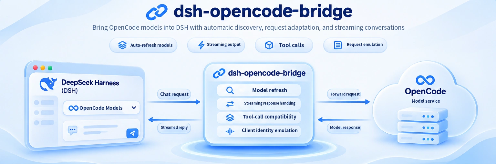
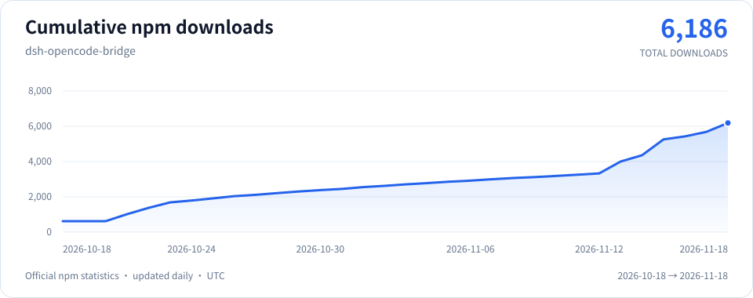

<p align="center">
  
</p>

<h1 align="center">OpenCode Bridge</h1>

<p align="center">
  <a href="https://www.npmjs.com/package/dsh-opencode-bridge"></a>
  <a href="https://dshfind.com/en/plugins/Vikrant-Aleph/dsh-opencode-bridge?ref=badge"></a>
  <a href="https://www.npmjs.com/package/dsh-opencode-bridge"></a>
  <a href="https://github.com/Vikrant-Aleph/dsh-opencode-bridge/stargazers"></a>
  <a href="https://github.com/Vikrant-Aleph/dsh-opencode-bridge/commits/main"></a>
  <a href="LICENSE"></a>
  <a href="https://www.npmjs.com/package/dsh-opencode-bridge"></a>
</p>

[中文](README.md) | English

Use [OpenCode](https://opencode.ai)'s free models in
[DeepSeek Harness](https://github.com/deepseek-ai/deepseek-harness) (DSH) — no
OpenCode account or API key needed. Optional context trimming and egress rotation are
included.



## Features

**Impersonates the official OpenCode client so DSH can use OpenCode's free models.**

It reproduces the official client's request headers, the request shape the
gateway requires, and the TLS and HTTP fingerprints. It is an `LlmAdapter`, so it plugs
into DSH's existing loop: the agent loop, permissions and tool
execution stay with DSH, and DSH resolves every tool call itself. What the gateway does
and does not check is described [below](#how-opencode-identifies-a-client).

Also included:

- **Automatic model refresh** — reads the OpenCode model catalog, the same source the official client uses, every five minutes, adding and removing models as it changes and keeping the last good list when a refresh fails.
- **Optional context trimming** — clears reasoning only from confirmed completed turns, off by default.
- **Optional egress rotation** — several HTTP(S) or SOCKS proxies in order, trying the next available entry when a connection fails.
- **Code Mode tool calling** — free models call tools through a program passed to `execute`, reusing DSH's native PTC components; the behavior is closer to DSH's PTC mode and only affects the free-model routes.

## Install

### In DSH Desktop

1. Open **Plugins** in the sidebar, then click **Add plugin** in the top-right corner.
2. Enter:

   ```text
   dsh-opencode-bridge@1.1.1
   ```

3. Prefer the official npm registry under **Installation source**; mirrors may lag.
4. Click **Install** and wait for completion.

### From the command line

```sh
dsh plugin --profile desktop add dsh-opencode-bridge@1.1.1
```

Replace `desktop` with your profile. If `dsh` is not on your `PATH`:

```sh
npx @deepseek-ai/dsh plugin --profile desktop add dsh-opencode-bridge@1.1.1
```

Then pick a model under **OpenCode Bridge** in the model picker. If none appears,
restart that DSH profile.

No API key or hand-edited configuration is needed. Model-list changes reach the picker
without restarting the plugin. Refresh intervals and the rest of the configuration are
in the [configuration reference](TECHNICAL.us.md#7-configuration).

## How OpenCode identifies a client

Everything below was measured — one variable at a time, from a single runtime, against
the real gateway.

### What is checked

| Requirement | What we measured |
|---|---|
| `User-Agent` | Use an official client identifier; the plugin defaults to the captured `opencode/latest/2.2.0/cli`. |
| **At least one declared tool** | An empty `tools` array is refused. |
| **An `<env>` block in the system prompt** | A 177-byte prompt containing nothing but that block passes. The same prompt without it is refused. |
| **Tool name shape** | An unrecognized name with underscores, dashes, dots or capitals is refused; a name the gateway recognises may carry separators. The plugin converts names. |
| **Tool declaration content** | Declaring many rich tools at once (real descriptions + complex schemas) is refused; a same-size neutral tool block passes. |

These checks are satisfied by the official client's own form, which is why they work as a
client check. A user can rewrite the system prompt and prune the tool list, but the client
still appends an `<env>` block and still declares tools. The declaration-content check is
satisfied by the official client's Code Mode — only a few tools on the wire, the full
catalog in the system prompt; the plugin uses Code Mode for the free models too.

Tool names are easy to misread: the gateway answers a non-conforming name with
`FreeUsageLimitError`, the same error it returns when the quota is spent. The plugin
converts names on the way out and restores the original on the way back, so tool calls
are unaffected.

### What is not checked

None of these is part of the client check:

- **The official tool manifest.** A custom agent with a single tool passes.
- **The official system prompt.** A user's own prompt passes.
- **The values inside `<env>`.** Anything works.
- **The Code Mode catalogue.** A catalogue synthesised from different tool names passes (the names must still be separator-free).
- **The runtime.** Bun and Node sending a zero-tool body are refused the same way.
- **The TLS fingerprint alone.** Aligning it byte for byte (cipher suites, curves, extension order, signature algorithms) does not change the outcome.

### Caveats

All of the above are observations from 2026-11-13 through 2026-11-17. The full
evidence trail and the hypotheses that were ruled out are in the
[camouflage policy](CAMOUFLAGE.us.md).

## TLS and HTTP fingerprint camouflage

**Status: aligned; necessity unproven.**

It exists to cover fingerprint checks that may be added later, and to make this traffic
indistinguishable from the official client at those layers.

### TLS fingerprint

Node cannot express the official handshake. OpenSSL orders extensions itself and offers
no post-quantum key share, producing a different hello (roughly 270 bytes against 1482).
The plugin therefore delegates the handshake to
[`wreq-js`](https://github.com/sqdshguy/wreq-js), a Rust engine on BoringSSL — the same
underlying TLS library the official client uses.

| Element | Value |
|---|---|
| Cipher suites | The captured 17, in capture order, starting `TLS_AES_128_GCM_SHA256`, `TLS_AES_256_GCM_SHA384`, `TLS_CHACHA20_POLY1305_SHA256` |
| Supported groups | `X25519MLKEM768`, `X25519`, `P-256`, `P-384` — the default profile also offers a bare `MLKEM768` group; the official client does not have it, so it is removed |
| Signature algorithms | The captured 11, in order. Two are easy to get wrong: `0x0807` is **ed25519**, not `rsa_pss_pss_sha256` (that is `0x0809`), and `0x0603` is `ecdsa_secp521r1_sha512`, written `ECDSA+SHA512` by BoringSSL |
| Extensions | The captured 12, in capture order, with GREASE, ECH and ALPS disabled |
| ALPN | `http/1.1` only — the official client never offers `h2`, so HTTP/2 settings are not part of its fingerprint |
| Result | A 1482-byte `ClientHello`; byte-identical to the capture once random fields, session id and key-share payloads are normalised |

### HTTP fingerprint

| Element | Detail |
|---|---|
| Header names and casing | `Authorization`, `Content-Type`, `User-Agent`, `Connection`, `Accept`, `Host`, `Accept-Encoding`, `Content-Length` are capitalised as captured; the custom `b3`, `traceparent` and `x-opencode-*` headers stay lowercase |
| Header order | The captured order, including `Host`, `Accept-Encoding` and `Content-Length` in positions 14–16 — supplied explicitly, because the transport would otherwise append them at the end |
| `Accept-Encoding` | `gzip, deflate, br, zstd`, Bun's default; Node's default omits `br` and `zstd` |
| `Connection` | `keep-alive`, over a persistent pooled connection reused across turns |
| Deliberately absent | No `sec-ch-ua*`, `sec-fetch-*`, `priority` or `accept-language` — browser emulation adds these by default and the official client never sends them, so they are explicitly suppressed |

The result is byte-identical to the captured request apart from `x-opencode-project`,
which is derived from the working directory.

`wreq-js` is an **optional** dependency. Without its native binding the plugin falls back
to plain `fetch`, losing the TLS alignment but still working — and in some proxy setups
plain `fetch` cannot connect at all, so the transport has value beyond fingerprinting.

## Optional context trimming

Open **Settings → OpenCode Bridge → Context trimming** and enable **Trim reasoning from
completed turns**. Off by default (full replay).

Only reasoning from confirmed successful turns is cleared; the current tool chain and
uncertain or interrupted history stay intact, and required `reasoning_content` fields
are still sent. The setting affects new requests only, leaves local history untouched, and
does not interrupt a running request. Savings depend on the upstream, and DSH's local
estimate may still count the full history — turn it off if continuity suffers.

## Optional egress rotation

Without configuration the plugin connects directly.

1. Open **Settings → OpenCode Bridge → Egress rotation (optional)**.
2. Add proxies one at a time, such as `http://127.0.0.1:7890` or `socks5h://127.0.0.1:1080`. `direct` (this machine) can stay in the list.
3. Use **Test all** to check connectivity. Cooling entries are skipped so no early request is made. Adding or removing an entry saves and applies immediately.

Entries are tried in list order; connection failures cool an entry temporarily. **Clear cooldowns** immediately clears live egress waits and legacy cooldown records, without restarting.

A `FreeUsageLimitError` ends the current run without automatic retries, egress rotation or a saved model cooldown. Sending another message makes a new upstream request.
DSH makes at most two automatic retries for transient throttling, accepting retry delays of at most 15 minutes. Replies that have already started producing output are never replayed.

**HTTP(S), SOCKS4/4a and SOCKS5/5h** are supported.

## Important notes

- **Unofficial project.** Not affiliated with OpenCode or DeepSeek. Upstream protocols, models and free quotas can change; continued availability is not guaranteed.
- **Third-party processing.** Model requests go to OpenCode's service and, if configured, through your proxy. Do not send content you would not entrust to those parties.
- **Attachments.** Image input follows each model's declared capability. DSH prepares request versions and applies the image budgets and offload decisions; ordinary files travel as text handles. Image bytes and data URLs never reach the diagnostic logs.
- **Credentials and logs.** Proxy passwords are stored in plaintext locally. SOCKS authentication is not encrypted by SOCKS itself — use proxies and networks you trust, do not publish the configuration file, and check logs and screenshots before sharing them.

## Troubleshooting

| Problem | What to try |
|---|---|
| No models after installation | Check the target profile, confirm the plugin is enabled, restart DSH, verify network access. |
| HTTP 429 | Retry later. If it persists, check that the plugin is up to date. With proxies configured, check their status in Settings. |
| HTTP 403 or 503 | Check for plugin updates and upstream status, then retry. These do not trigger proxy failover. Report persistent cases. |
| Tool calls fail | Check the **Diagnostic log** tab; a call DSH never declared cannot be dispatched. |

For bugs or feature requests, [choose an Issue form](https://github.com/Vikrant-Aleph/dsh-opencode-bridge/issues/new/choose)
and include versions, reproduction steps and expected versus actual behaviour. Redact
logs first — never include API keys, proxy passwords or private conversations.

## Development and documentation

<details>
<summary>Build and install from source</summary>

Requires **Node.js ≥ 20.18.1** and pnpm; Node.js 22 or 24 LTS is recommended.

```sh
git clone https://github.com/Vikrant-Aleph/dsh-opencode-bridge.git
cd dsh-opencode-bridge
pnpm install
pnpm build
pnpm test
```

Build output is not committed. To install a local build:

```sh
pnpm pack
dsh plugin --profile desktop add ./dsh-opencode-bridge-1.1.1.tgz
```

</details>

[Technical documentation](TECHNICAL.us.md) ([中文](TECHNICAL.md)) covers the wire
protocol, module layout, full configuration, testing and maintenance rules.

## Cumulative downloads



Includes the full history since the first release, summed from [npm's official daily statistics](https://github.com/npm/registry/blob/main/docs/download-counts.md)
and updated automatically each day. The chart shows its cutoff date.

## References and credits

Every protocol behaviour was established by measuring the official client. The captures and
the principles derived from them are collected in the
[camouflage policy](CAMOUFLAGE.us.md). The design stage also compared the following
community projects, to decide which approaches were worth following and which were not. No
code was copied from any of them.

- [FishBottle7/opencode2dsh](https://github.com/FishBottle7/opencode2dsh)
- [x5427876/dsh-opencode-free](https://github.com/x5427876/dsh-opencode-free)
- [DragonHorizon-xtihc/dsh-connect-opencode-free](https://github.com/DragonHorizon-xtihc/dsh-connect-opencode-free)
- [1624318455/dsh-plugin-adapter](https://github.com/1624318455/dsh-plugin-adapter)
- [randomix777/dsh-opencode-zen](https://github.com/randomix777/dsh-opencode-zen)
- [seonzzy/dsh-zen-adapter](https://github.com/seonzzy/dsh-zen-adapter)
- [jasonxu114514/opencode2api](https://github.com/jasonxu114514/opencode2api) — consulted only
  for its issue discussion of the free allowance decaying with egress IP; no code was used
  (that project is GPL-3.0)

## License

Licensed under [MIT](LICENSE).
